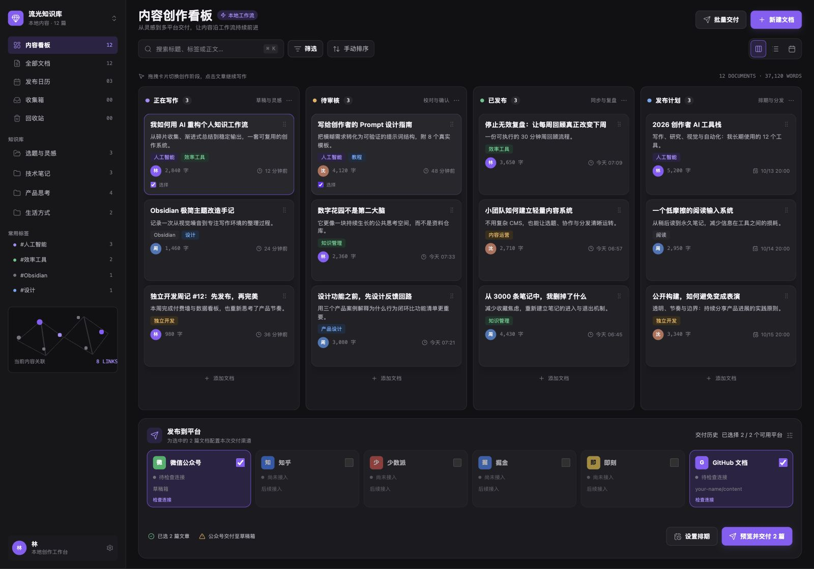

# Content Workbench · Obsidian 内容创作工作台

在 Obsidian 中管理选题、写作、审核与排期，将选中的文章同步到**微信公众号草稿箱**和 **GitHub Markdown 仓库**。笔记仍是本地 Markdown 文件，点击卡片即可用原生编辑器继续写作。

**当前版本：v0.1.0 开发预览版 · 仅桌面端 · Obsidian ≥ 1.14.0**。尚未上架 Obsidian 社区插件目录。



_浏览器演示截图，使用虚构文章和作者；平台连接为演示状态。界面参考指定 Figma 设计，实际尺寸受 Obsidian 窗口和主题影响。_

[安装](#安装) · [使用](#使用流程) · [GitHub 配置](#github-markdown-配置) · [公众号配置](#微信公众号配置) · [开发](#本地开发) · [验证记录](VALIDATION.md)

## 已实现

| 能力         | 当前行为                                                         |
| ------------ | ---------------------------------------------------------------- |
| 创作看板     | 正在写作、待审核、已发布、发布计划四列；另有收集箱和软删除回收站 |
| 视图与检索   | 看板、列表、月历；标题/正文/标签搜索，负责人/文件夹/标签筛选     |
| 卡片操作     | 跨列拖动、手动列内排序、落点提示、自动滚动、撤销、键盘与菜单操作 |
| 原生文件联动 | 编辑、改名、移动、删除后更新索引；稳定文章 ID 与可配置属性映射   |
| 微信公众号   | 本地图片与封面上传、草稿创建与更新、已关联草稿复用、远端内容核对 |
| GitHub       | Markdown 与附件一次 commit；重复内容跳过、远端冲突保护、结果核对 |
| 交付记录     | 分文章、分渠道保留快照与结果；失败恢复、结果不明时阻止盲目重发   |
| 减少动态效果 | 可强制关闭位移动画，或跟随系统偏好；保留拖动与键盘操作           |

公众号同步成功代表“草稿已同步”，GitHub 成功代表“仓库已同步”。交付结果与创作阶段分别管理，不会自动将文章标记为“已发布”。

## 安装

### 使用安装包

1. [下载安装包](https://github.com/wang-zhengxin/obsidian-content-workbench/raw/refs/heads/main/releases/content-workbench-0.1.0.zip)，可用同目录的 [SHA-256 文件](releases/content-workbench-0.1.0.zip.sha256) 核对下载结果。
2. 在 Vault 中创建 `.obsidian/plugins/content-workbench/`，将 ZIP 内的文件直接解压到该目录。若使用自定义配置目录，以实际目录代替 `.obsidian`。
3. 确保目录结构如下，尤其需要保留 `assets/`：

   ```text
   <Vault>/.obsidian/plugins/content-workbench/
   ├── main.js
   ├── manifest.json
   ├── styles.css
   ├── assets/
   ├── licenses/
   ├── LICENSE
   ├── THIRD_PARTY_NOTICES.md
   ├── README.md
   └── VALIDATION.md
   ```

4. 重新加载 Obsidian，在「设置 → 社区插件」中启用 **Content Workbench**。
5. 点击左侧看板图标，或运行命令 **Content Workbench: 打开内容创作看板**。
6. 在插件设置中选择内容目录，默认仅索引 `内容/` 下的 Markdown 笔记，再配置需要的渠道。

更新现有安装时，替换程序、样式和资源文件，保留原有 `data.json`、`state/` 及凭据。安装包不含任何账号配置或文章记录。

### 从源码安装

需要 Node.js 24+、npm，以及打包时使用的 `zip` 命令。

```sh
git clone https://github.com/wang-zhengxin/obsidian-content-workbench.git
cd obsidian-content-workbench
npm ci
npm run build
```

将 `dist/` 中的插件文件复制到上述安装目录，或运行 `npm run package` 生成安装包。无需重新下载 Figma 资源。

## 使用流程

1. **写作**：在内容目录创建笔记，或点击看板的「新建文档」。点击卡片进入 Obsidian 原生编辑器。
2. **整理**：拖动卡片调整阶段；手动排序模式支持列内排序。卡片菜单也可以修改阶段、设置排期、软删除与恢复。
3. **选择**：勾选卡片，或按 ⌘ / Ctrl 点击多选，再选择公众号、GitHub 渠道。
4. **预览**：点击「预览并交付」，检查正文、Markdown 输出、图片路径和导出提示。
5. **交付**：确认后发送所选文章及其本地附件；在「交付历史」查看各渠道结果。
6. **核对**：成功记录可只读「核对远端」。GitHub 对比 Markdown 和全部附件字节；公众号核对正文、图片、封面及排版属性。

排期用于日期管理和月历展示，**不会到期自动发布，关闭 Obsidian 后也不会执行任务**。公众号需要在后台完成预览与正式发表。

| 快捷键     | 操作                 |
| ---------- | -------------------- |
| ⌘ / Ctrl K | 聚焦工作台搜索       |
| Enter      | 打开当前卡片         |
| 空格       | 选择卡片             |
| F2         | 打开卡片菜单         |
| Esc        | 取消拖动或关闭对话框 |
| ⌘ / Ctrl Z | 撤销上次看板修改     |

快捷键在对应工作台上下文生效，输入框和原生编辑器保留各自的编辑操作。

## 文章属性

```yaml
---
content_id: 7eb9cff7-0456-433a-bcd2-77753992a9ed
title: 示例文章
summary: 一段用于卡片和微信摘要的介绍
owner: 我
tags: [知识管理, 写作]
stage: writing
board_order: 1024
planned_at: 2026-10-20T20:00
cover: 附件/文章封面.png
---
# 示例文章

正文仍然是普通 Markdown。

![[文章封面.png]]
```

现有笔记无需先套用模板。第一次交付所选文章时会补全稳定 ID；改名或移动不改变 ID。复制笔记出现重复 ID 时，可在设置中执行「补全 / 修复 ID」。属性名与阶段值均可映射到现有 Vault。

| 默认属性            | 用途                                                 |
| ------------------- | ---------------------------------------------------- |
| `content_id`        | 文章的稳定标识，用于远端关联                         |
| `title` / `summary` | 标题与摘要                                           |
| `owner` / `tags`    | 负责人、标签及筛选                                   |
| `stage`             | `inbox`、`writing`、`review`、`published`、`planned` |
| `board_order`       | 阶段内手动顺序                                       |
| `planned_at`        | 计划日期与时间                                       |
| `cover`             | Vault 中的本地封面图片路径                           |
| `archived_at`       | 软删除时间；原文件保留，支持恢复                     |

手动标记“已发布”还会记录 `published_source: manual` 与时间。

## GitHub Markdown 配置

这里配置的是**文章输出仓库**，可以与本插件源码仓库不同。

1. 准备已初始化的仓库和已有分支，例如 `main`。
2. 创建限定该仓库的 fine-grained token，授予 **Contents: Read and write** 权限，并保留仓库元数据读取权限。
3. 在插件设置中填写仓库所有者、仓库名称、分支及 Token。
4. 配置文档目录、附件目录与文章路径模板，点击平台卡片上的「检查连接」。

默认输出：

```text
<目标仓库>/
├── content/<content_id>.md
└── assets/<图片内容 hash>.<扩展名>
```

路径模板支持 `{id}`、`{slug}`、`{title}`，例如 `{slug}/index.md`。已经关联的文章沿用原路径，标题变化不会另建一篇文章。

同批 Markdown 与附件通过 Git Data API 一次提交，保留仓库其他文件，分支更新不使用 force。远端目标文件或附件发生冲突时停止；内容未变时跳过新 commit。受保护分支可能拒绝直接写入，当前未实现 PR 交付模式。

默认 frontmatter 白名单为 `title`、`description`、`summary`、`tags`、`date`、`slug`，可在设置中修改。仅导出所选笔记：嵌入笔记不递归展开；WikiLink 目标也在同批导出时才转换成相对链接，其余在预览中提示。

## 微信公众号配置

1. 公众号需要具备草稿接口权限。在公众号开发设置中取得 AppID、AppSecret，并按要求配置 API 出口 IP 白名单。
2. 在插件设置中填写 AppID、AppSecret 和草稿署名，然后「检查连接」。凭据直接填写在 Obsidian 中。
3. 为文章设置本地 PNG/JPEG 封面；未指定时使用正文第一张本地图片。
4. 预览并交付，在公众号后台查看草稿，再用微信客户端确认实际显示。

支持标题、段落、列表、引用、代码块、表格和本地图片。正文图与封面分别上传，缓存按 AppID 与图片内容 hash 保存。每篇文章创建独立草稿，再次同步更新已关联草稿；不自动合并为多图文。

普通 Markdown 使用默认微信排版。HTML 中的本地 `` 可作为附件导出；已转换为安全行内样式的 HTML 笔记可设置 `wechat_preserve_styles: true` 保留排版。当前没有通用 HTML 文件导入按钮，独立 HTML 的样式表和 data 图片需预先转换。

外部图片需先保存为 Vault 附件；SVG、AVIF、Mermaid 和公式需先转为可用的 PNG/JPEG 图片。预览提示的缺失图片、封面等问题应在交付前处理。

默认直连微信官方 API。可选使用自己控制的 HTTPS 代理，以 `url` 查询参数接收目标地址，原样转发方法、请求头和正文。代理会接触凭据及文章内容；项目不提供公共代理。

当前不调用正式发布或群发接口。成功结果包含草稿标识、同步时间和后台入口，不提供未经验证的具体草稿深链。

## 失败处理与数据保存

每篇文章的每个渠道有独立任务，一端失败不会抹掉另一端的成功记录。历史保存实际发送的内容快照，后续编辑不会改变旧任务。

| 情况                          | 处理方式                                                                    |
| ----------------------------- | --------------------------------------------------------------------------- |
| GitHub 仓库接口返回 404       | 检查 owner/repo、账号访问权、Token 的目标仓库授权；404 不一定代表仓库不存在 |
| GitHub 仓库可读，分支返回 404 | 检查目标分支名称与 Contents 读取权限                                        |
| 微信 `40164`                  | 将错误提示的出口 IP 加入该公众号的 API IP 白名单，再检查连接                |
| 远端内容冲突                  | 先核对远端修改，再决定如何合并，插件不会强制覆盖                            |
| 请求超时、结果不明            | 先「核对结果」；确认远端未交付后才重试                                      |
| 已有微信草稿需要关联          | 在后台确认草稿后，用历史中的核对操作填写 `media_id`                         |

本机重启后，发送中任务转为“结果待核对”，尚未发送的任务转为失败，不自动重发。建议在设置中指定唯一执行设备；其他设备的任务不会由本机自动恢复执行。

文章属性保存在 Markdown；普通插件配置位于 `data.json`；交付任务、关联、图片缓存和快照位于：

```text
<Vault>/.obsidian/plugins/content-workbench/state/
```

快照包含文章和本地图片，应作为私人 Vault 数据管理。GitHub Token 与 AppSecret 使用 Obsidian SecretStorage，普通配置不保存这两个明文凭据。仓库不包含测试库、真实账号配置或交付历史。

## 本地开发

```sh
npm ci
npm test
npm run build
npm run preview
```

`npm run preview` 自动构建并在 `http://127.0.0.1:4317` 提供浏览器演示。使用虚构数据与模拟宿主，不向公众号或 GitHub 发请求，不能替代 Obsidian 内的连接验证。

| 命令                   | 用途                                                          |
| ---------------------- | ------------------------------------------------------------- |
| `npm run build`        | 类型检查、CSS 格式检查与生产构建，输出到 `dist/`              |
| `npm run dev`          | 监听源码并构建开发版 JS；样式变更后需重新构建                 |
| `npm test`             | 运行自动化测试，不访问真实账号                                |
| `npm run preview`      | 构建并启动本地浏览器演示                                      |
| `npm run package`      | 重新构建，生成 ZIP 与 SHA-256 文件                            |
| `npm run seed`         | 在新的源码副本中创建虚构演示库；已有 `test-vault/` 时拒绝覆盖 |
| `npm run install:test` | 将已构建插件安装到新演示库；已有 Obsidian 配置时拒绝覆盖      |

如需原生宿主测试，在**新的源码副本**中依次运行：

```sh
npm run build
npm run seed
npm run install:test
```

再用 Obsidian 打开生成的 `test-vault/`。现有个人库的安装和更新按上方手动安装说明操作。

### 源码结构

```text
src/
├── main.tsx              Obsidian 视图、设置、文件事件与凭据接口
├── repository.ts         Markdown 索引、阶段、排序与撤销
├── exporter.ts           内容快照、图片解析与安全 HTML
├── publisher.ts          分渠道交付队列与恢复、核对
├── state-store.ts        任务、关联及缓存的文件存储
├── connectors/
│   ├── github.ts         Git Data API 提交与远端比对
│   └── wechat.ts         素材上传、草稿创建/更新与核对
└── ui/
    ├── Workbench.tsx     看板、列表、日历、预览与交付面板
    └── dnd.ts            拖动、浮动卡片、落点和自动滚动
```

运行资源已保存在 `assets/`，名称映射见 `src/asset-map.json`；演示素材见 `examples/`。安装包采用文件白名单，不包含开发测试数据。

## 当前边界与验证

v0.1 支持微信公众号草稿和 GitHub Markdown 交付。知乎、少数派、掘金、即刻等卡片为禁用占位。后台定时执行、公众号正式发布/群发、GitHub PR 模式、移动端和多人协作不在当前实现范围。

自动化测试覆盖文件联动、拖动、键盘、导出、连接器、持久化、冲突与不明结果恢复。已在 Obsidian 1.14.4 中检查原生交互，并完成真实账号的草稿创建/更新与 GitHub 提交验证。测试范围、历史人工验收与未测项目见 [VALIDATION.md](VALIDATION.md)。

## 参考与许可

代码使用 [MIT License](LICENSE)，依赖许可证随安装包保留。Figma 导出的设计资源不自动纳入代码的 MIT 授权，见 [THIRD_PARTY_NOTICES.md](THIRD_PARTY_NOTICES.md)。

- [obsidian-kanban-action-planner](https://github.com/dsebastien/obsidian-kanban-action-planner)：拖动阈值、浮动卡片、落点线、自动滚动与动画节奏参考。
- [obsidian-wechat-converter](https://github.com/DavidLam-oss/obsidian-wechat-converter)：素材上传与草稿创建/更新流程参考。
- [Wechatsync](https://github.com/wechatsync/Wechatsync)：平台适配调研参考，未集成浏览器扩展或驱动代码。
- [Figma 设计](https://www.figma.com/design/PhfAPIXr1FvFWWN4kkCFw9/Untitled?node-id=2-4255)：布局、颜色与静态图形参考。

反馈问题请在 [Issues](https://github.com/wang-zhengxin/obsidian-content-workbench/issues) 提供复现步骤、Obsidian/插件版本和已脱敏的错误信息。
